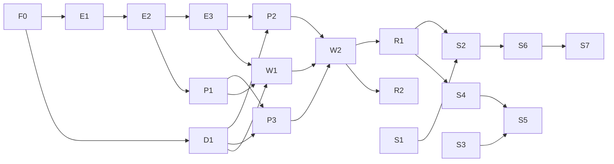

# Phased issue list

Ready to file once this ADR is approved. Each issue names its queue marks, what blocks it, what it builds and
when it is done. Engine issues share the serial group `engine`. The design issue D1 and the engine issues start
together; nothing with a screen starts before D1 is approved.

## This repo

**F0. `restart: foundation, strict gates, dead code out`**
- Builds: deletes the cockpit, `web/` (but `geometry.js`), `src/`, `bundles/`, the dead scripts, tests and docs
  ([cutover.md](cutover.md) section 1); root Cargo and npm workspaces; `.gatekeeper/` with every pack on;
  `.drover/arch.toml`, `rules.md`, `design.md`, `verify.md`; `ci.yml`; `justfile`; `catalog/synthetic.json`;
  the `local/legacy`, `local/tree` and `local/parity` gates; README with intent and non-goals.
- Blocked on: open question 5 (the hygiene gate and the licensor's name).
- Done when: `gates / done` is green with no baseline file and one `[off]` entry (`core/cap`); the 299 recorded
  steps pass through `local/legacy`. Then the owner adds the required checks and `drover protection` passes.

**D1. `design: landing page, wizard, results, calc steps, 3D tower`** `--design`
- Blocked on: F0. Builds: mockups of [screens.md](screens.md) at 1440 and 390, on Blocks, in `docs/design/restart/`.

**E1. `engine: carry the physics and ct-engine into crates/`** `--serial engine`
- Blocked on: F0. Builds: `crates/engine` and `crates/cli` from `rust/src` and `rust/tests`; comments cut to
  the policy, module notes to `docs/engine/`; `lib.rs` with `pub mod` lines only; `tools/parity/`.
- Done when: every gate passes with no baseline; the parity run reports 299 steps within today's tolerances;
  `validation/` is byte-identical; no test assertion changed. `rust/src` and `rust/tests` are gone.

**E2. `api: three typed operations over a JSON ABI, and the WASM size gate`** `--serial engine`
- Blocked on: E1. Builds: `crates/api` (wire types, `open`, `size`, `rate`, the worked sheet by section, the
  ABI); the size build profile; `crates/gen` writing `packages/engine/src/gen/types.ts`; the raw ABI caller in
  `packages/engine`; the `local/wasm` gate. Its first commit records the measured WASM size.
- Done when: `engine.wasm` is at most 150,000 bytes gzip; WASM and native agree to 1e-12 on every recorded
  `size` and `rate` case; `rate` reproduces the adapter's recorded run; `ct-engine select` prints the same
  worked values as before. `rust/` is gone, and with it `local/legacy`.

**E3. `geometry: the tower as data from the engine`** `--serial engine`
- Blocked on: E2. Builds: `crates/geometry` with one file per part; `Rating.geometry`.
- Done when: for the four synthetic towers every dimension equals what `web/geometry.js` gave, recorded as
  vectors in the PR's first commit; `web/geometry.js` is deleted.

**P1. `packages/engine: worker, session, newest call wins`**
- Blocked on: E2. Builds: `loadEngine`, `open`, `size`, `rate`, the refusal union, worker replacement.
- Done when: tests drive the real WASM: a catalog violation is a value; a second `size` supersedes the first;
  a failed fetch ends in `Failed` and a retry works.

**P2. `packages/tower3d: the parametric tower`** (three PRs: static scene and cutaway; fans and particles; morph, picking and labels)
- Blocked on: E3, D1. Builds: the parts folder, `createTowerView`, the `drafthouse-tower` element, quality
  tiers, reduced motion, fallback.
- Done when: screenshots of the four synthetic towers at 1440 and 390 match the approved design; a geometry
  change reuses the scene objects; no model, texture or environment file exists.

**P3. `packages/wizard: steps, ranking, calc steps`**
- Blocked on: P1, D1. Builds: the reducer, one file per step, the Blocks screens, the screen fixtures for
  `blocks check`, the `local/guard` gate.
- Done when: every state of [screens.md](screens.md) has a fixture with no guard finding; the wizard imports
  neither Three.js nor the tower.

**W1. `apps/web: shell, landing page, prerender, speed gates`**
- Blocked on: P1, E3, D1. Builds: the Vite app, the Blocks shell, the landing screen prerendered to HTML with the
  default design's geometry and poster written in at build, the island trigger, the `local/first-load` and `local/lighthouse` gates.
- Done when: first-load JavaScript is at most 120,000 bytes gzip on every route; a cold load requests neither
  the engine nor the tower chunk and one scroll requests both; Lighthouse mobile performance is 95 or more.

**W2. `apps/web: the wizard and the live tower`**
- Blocked on: W1, P2, P3. Builds: the wizard routes, the two-beat update, the full tower view, `.drover/verify.md` filled in.
- Done when: verify drives duty to ranking to calc steps to the tower at 1440 and 390; the three gates stay green.

**R1. `release: the site archive and the embed package`**
- Blocked on: W2. Builds: `packages/embed`; `release.yml` (a tag publishes both artifacts with digests and a
  manifest; a dispatch is a dry run; a second job verifies a fresh download); `tools/release/`.
- Done when: a dry run produces both artifacts; the embed installs into an empty Vite project, type-checks and
  builds with no other dependency; the site archive passes synergy-apps' verifier from S1.

**R2. `perf: a sizing in under one second`** `--perf`
- Blocked on: W2. Builds: whatever brings `size` on the synthetic catalog at the default duty under 1 s in
  the browser on the CI runner, then a gate at that number.
- Done when: the baseline commit and the result are in the PR; the parity run is unchanged.

## synergy-apps

**S1. `drafthouse deploy: accept the site piece`**
- Builds: the fetch script and pin helper accept `drafthouse-site-<version>.tar.gz` with `piece: "site"`
  beside the cockpit archive; tests for both; the SWA config checked against the new site.
- Done when: a dry run verifies a v1 dry-run archive and still verifies v0.4.3.

**S2. `drafthouse pins: staging to v1.0.0`**
- Blocked on: S1, R1 and the tag. Done when: the staging site serves the new landing page and wizard.

**S3. `drafthouse catalog: tower cells, water-quality factors, and the engine mapping`** (waits for open question 1)
- Builds: the two missing kinds in the catalog, and `toEngineCatalog()`, which maps approved records to the
  engine's `Catalog`. The mapping and the data stay in synergy-apps.
- Done when: the approved catalog opens in the engine with no violation.

**S4. `admin: install the embed by pin`**
- Blocked on: R1. Builds: `embedSha256` in each pin; a fetch script that verifies the embed by digest and
  unpacks it as a workspace package admin depends on; a CI check that the unpacked package matches the pin.
- Done when: staging and production each build with the embed their own pin names.

**S5. `admin: the sizing section`** `--design`
- Blocked on: S3, S4. Builds: the wizard and tower mounted in the Drafthouse shell on the real catalog; the
  admin CSP gains `wasm-unsafe-eval` and same-origin workers.
- Done when: a Drafthouse user sizes a tower on approved records in admin; no frame is involved.

**S6. `drafthouse pins: production to v1.0.0`** (the owner's promote step)

**S7. `drafthouse deploy: drop the cockpit piece`**
- Blocked on: S6. Done when: the fetch script accepts only the site piece.
