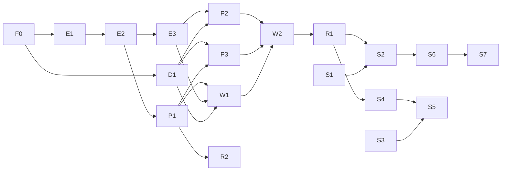

# Phased issue list

Ready to file once this ADR is approved. Each issue names its queue marks, what blocks it, what it builds and
when it is done. Engine issues share the serial group `engine`. The design issue D1 and the engine issues start
together; nothing with a screen starts before D1 is approved.

Every issue leaves the whole tree building and `gates / done` green, so the next one starts from a green
`staging`. An issue deletes or moves a file only in the PR that also deletes or re-points every file that builds
from it. For the engine issues, the `Leaves` line says what old code is still there and still builds;
[cutover.md](cutover.md) section 1 has the table and the run that checked F0.

## This repo

**F0. `restart: foundation, strict gates, dead code out`**
- Builds: deletes the cockpit, `web/` (but `geometry.js`), `src/`, `bundles/`, the dead scripts, tests and docs
  ([cutover.md](cutover.md) section 1). Two cockpit files are kept by moving them in the same PR: the synthetic
  catalog becomes `catalog/synthetic.json`, and `numfmt.rs`, which the adapter compiles by path, moves into
  `rust/cockpit-adapter/src/`. Adds the root Cargo workspace (first member `crates/blocks`) and the npm
  workspaces; `.gatekeeper/` with every pack on; `.drover/arch.toml`, `rules.md`, `design.md`, `verify.md`;
  `ci.yml`; `justfile`; the `local/legacy`, `local/tree` and `local/parity` gates; README with intent and
  non-goals.
- Blocked on: open question 5 (the hygiene gate on `LICENSE` and `NOTICE`).
- Leaves: `rust/` whole and building, with `scripts/parity/` and `web/geometry.js`. Nothing in them names a
  deleted path.
- Done when: `gates / done` is green with no baseline file and one `[off]` entry (`core/cap`); `local/legacy`
  passes today's `cargo fmt`, `clippy` and `cargo test --workspace` in `rust/`; `local/parity` passes all 299
  recorded steps natively and all 299 through the WASM build. Then the owner adds the required checks and
  `drover protection` passes.

**D1. `design: the cockpit screen`** `--design`
- Blocked on: F0. Builds: the cockpit mockups of [screens.md](screens.md) at 1440 and 390, dark by default with
  the light toggle, on Blocks tokens, in `docs/design/restart/`. The mockups approved on this ADR's branch are
  its starting point.

**E1. `engine: carry the physics, ct-engine and the WASM ABI into crates/`** `--serial engine`
- Blocked on: F0. Builds: `crates/engine` (the physics, `lib.rs` moved as it is), `crates/cli` (the text
  commands as a library, and the bin) and `crates/wasm` (today's ABI, still answering the text commands) from
  `rust/src` and `rust/tests`; comments cut to the policy, module notes to `docs/engine/`; `tools/parity/` from
  `scripts/parity/` and `rust/wasm/binding.mjs`, re-pointed at the new crates. In the same PR the adapter's
  manifest is re-pointed at `crates/engine`; its source is not touched.
- Leaves: of `rust/`, only `cockpit-adapter/`, building and passing its recorded-run tests against
  `crates/engine`; and `web/geometry.js`.
- Done when: every gate passes with no baseline; the parity run reports 299 steps within today's tolerances
  natively and 299 through the WASM build within 1e-12 of native; `validation/` is byte-identical; no test
  assertion changed; `local/legacy` passes on the adapter.

**E2. `api: three typed operations over a JSON ABI, replay.wasm, and the WASM size gate`** `--serial engine`
- Blocked on: E1. Builds: `crates/api` (wire types, `open`, `size`, `rate`, the worked sheet by section);
  `crates/wasm` answering JSON by default and the text commands under the test-only feature `replay`; the size
  build profile for both; `crates/gen` writing `packages/engine/src/gen/types.ts`; the raw ABI caller in
  `packages/engine`; the `--engine api` parity leg; the `local/wasm` gate. Its first commit records the
  measured size of `engine.wasm` and the worst WASM spread over the 299 steps under the size profile. Deletes
  `rust/` (the adapter) and, with it, the re-export list in `crates/engine/src/lib.rs`.
- Leaves: `web/geometry.js` only.
- Done when: `engine.wasm` is at most 150,000 bytes gzip and answers a text command with a `usage` refusal;
  all 299 steps pass through `replay.wasm` within 1e-12 of native; WASM and native agree to 1e-12 on every
  recorded `size`, `open` and `rate` case; `rate` reproduces the adapter's recorded run; `ct-engine select`
  prints the same worked values as before.

**E3. `geometry: the tower as data from the engine`** `--serial engine`
- Blocked on: E2. Builds: `crates/geometry` with one file per part; `Rating.geometry`.
- Leaves: no old code. `local/legacy` is deleted.
- Done when: for the four synthetic towers every dimension equals what `web/geometry.js` gave, recorded as
  vectors in the PR's first commit; `web/geometry.js` is deleted.

**P1. `packages/engine: two workers, session, cancellable sizing`**
- Blocked on: E2. Builds: `loadEngine`, `open`, `size` with its abort signal, `rate`, the refusal union, the
  rate worker and the size worker, the `local/live` gate. Its first commit records the measured time of a `rate`
  beside a running `size`.
- Done when: tests drive the real WASM: a catalog violation is a value; a `rate` issued while a `size` runs
  answers in under 100 ms; an aborted `size` and a replaced one both resolve `superseded`, and the next `size`
  works; of three `rate` calls in a row the middle one resolves `superseded`; a failed fetch ends in `Failed`
  and a retry works.

**P2. `packages/tower3d: the parametric tower`** (three PRs: static scene and cutaway; fans and particles; morph, picking and labels)
- Blocked on: E3, D1. Builds: the parts folder, `createTowerView`, the `drafthouse-tower` element, quality
  tiers, reduced motion, fallback.
- Done when: screenshots of the four synthetic towers at 1440 and 390 match the approved design; a geometry
  change reuses the scene objects; no model, texture or environment file exists.

**P3. `packages/wizard: the cockpit panels, ranking, calc drawer`**
- Blocked on: P1, D1. Builds: the reducer, one file per panel in `src/steps/` (duty, build, ranking, picked, calc, compare,
  scenarios), undo and redo, the Blocks screens, the screen fixtures for `blocks check`, the `local/guard` gate.
- Done when: every state of [screens.md](screens.md) has a fixture with no guard finding; the wizard imports
  neither Three.js nor the tower.

**W1. `apps/web: shell, prerender, speed gates`**
- Blocked on: P1, E3, D1. Builds: the Vite app, the Blocks shell, the cockpit's first paint prerendered to HTML
  with the default design's numbers and poster written in at build, the island trigger, the `local/first-load` and `local/lighthouse` gates.
- Done when: first-load JavaScript is at most 120,000 bytes gzip on every route; a cold load requests neither
  the engine nor the tower chunk and one scroll requests both; Lighthouse mobile performance is 95 or more.

**W2. `apps/web: the live cockpit`**
- Blocked on: W1, P2, P3. Builds: the cockpit wired to the engine and the tower, the live update (cancel, rate at
  once, rank after the pause), the phone sheets, `.drover/verify.md` filled in.
- Done when: verify edits the duty, picks a row, opens the calc drawer and clicks a part at 1440 and 390, and drags a duty slider
  while a sizing runs: the tower and the numbers follow the drag; the gates stay green.

**R1. `release: the site archive and the embed package`**
- Blocked on: W2. Builds: `packages/embed`; `release.yml` (a tag publishes both artifacts with digests and a
  manifest; a dispatch is a dry run; a second job verifies a fresh download); `tools/release/`.
- Done when: a dry run produces both artifacts; neither holds `replay.wasm`; the embed installs into an empty
  Vite project, type-checks and builds with no other dependency; the site archive passes synergy-apps' verifier
  from S1.

**R2. `perf: a sizing in under one second`** `--perf`
- Blocked on: P1. Builds: whatever brings `size` on the synthetic catalog at the default duty under 1 s in
  the browser on the CI runner, then a gate at that number.
- Done when: the baseline commit and the result are in the PR; the parity run is unchanged.

## synergy-apps

These are written from this repo's side of the contract: what the host must accept, pin and provide. Where
each change lands in the host repo is for its own lanes; none of its files are named here.

**S1. `drafthouse deploy: accept the site piece`**
- Builds: the deploy accepts `drafthouse-site-<version>.tar.gz` with `piece: "site"` beside the cockpit archive,
  with tests for both; the hosting config is checked against what the new site needs
  ([cutover.md](cutover.md) section 3).
- Done when: a dry run verifies a v1 dry-run archive and still verifies the cockpit archive pinned today.

**S2. `drafthouse pins: staging to v1.0.0`**
- Blocked on: S1, R1 and the tag. Done when: the staging site serves the new cockpit.

**S3. `drafthouse catalog: every list the engine needs, and the engine mapping`** (waits for open question 1)
- Builds: whatever the host's catalog lacks of the engine's `Catalog` ([shapes.md](shapes.md) section 2), and a
  mapping from approved records to it. The mapping and the data stay in synergy-apps.
- Done when: the approved catalog opens in the engine with no violation.

**S4. `admin: install the embed by pin`**
- Blocked on: R1. Builds: each environment's pin gains the embed's sha256; the embed is fetched by pin, verified
  by digest and installed as a package admin depends on; CI checks that the installed package matches the pin.
- Done when: staging and production each build with the embed their own pin names.

**S5. `admin: the sizing section`** `--design`
- Blocked on: S3, S4. Builds: the cockpit and tower mounted in admin on the real catalog; the page may compile
  WebAssembly and start same-origin workers ([shapes.md](shapes.md) section 4).
- Done when: a signed-in user sizes a tower on approved records in admin; no frame is involved.

**S6. `drafthouse pins: production to v1.0.0`** (the owner's promote step)

**S7. `drafthouse deploy: drop the cockpit piece`**
- Blocked on: S6. Done when: the deploy accepts only the site piece.
