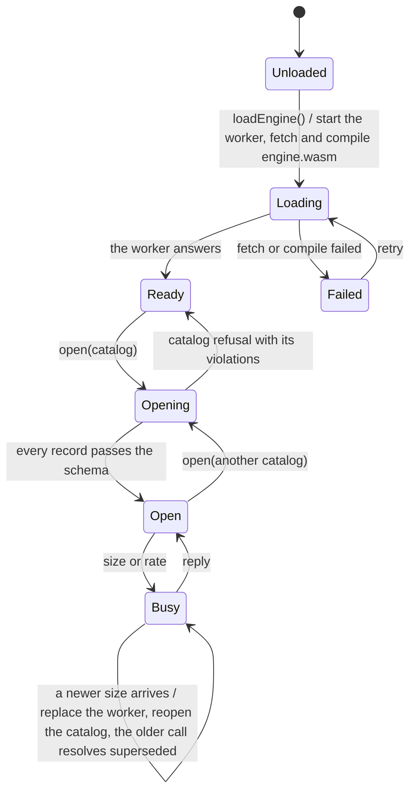

# Lazy loading and the speed budgets

## 1. The budgets

A kilobyte here is 1,000 bytes, and gzip is `gzip -9` of the file as shipped.

| Budget | Limit | How it is measured | Gate | On from |
|---|---|---|---|---|
| First-load JavaScript, every route | 120,000 bytes gzip | a cold visit in a headless browser, to network idle, with no input; the sum of every script fetched | `local/first-load` | W1 |
| Engine WASM | 150,000 bytes gzip | the release build of `engine.wasm` | `local/wasm` | E2 |
| Lighthouse mobile, performance | 95 or more | the built site served locally with compression; the median of three runs | `local/lighthouse` | W1 |
| Nothing early | zero requests for `engine.wasm`, the worker or the tower chunk before the trigger | the same cold visit; then one scroll, and both must arrive | `local/first-load` | W1 |
| Tower chunk (ours, not the issue's) | 200,000 bytes gzip | the built chunk | `local/first-load` | W1 |

Each gate is one file in `.gatekeeper/gates/` and runs on every PR. A gate starts in the PR that creates what it
measures. The limits live in the gate files; raising one is its own PR.

## 2. What loads when

| When | What | Size today or planned |
|---|---|---|
| The document | prerendered HTML, the stylesheet (Blocks' 19 KB plus ours), an inline SVG poster of the tower | no script needed to paint |
| First load | the Blocks shell, the layout, the route's screen builders, the island trigger | 77.6 KB for the shell (measured), up to 42 KB for ours |
| First input near the tower, or the tower opened | the tower chunk: Three.js and `packages/tower3d` | up to 200 KB |
| The same moment on a wizard route, or the first wizard input | `engine.worker.js` and `engine.wasm` | up to 150 KB |

- **The trigger is one rule on every route.** The tower chunk and the engine load on the first of: any user
  input (scroll, pointer, key, touch) while a tower island is within one screen of the viewport; or the user
  opens the tower or starts the wizard. Before that the island shows its poster. A cold load, which is what
  Lighthouse measures, fetches neither.
- **The landing tower needs no WASM.** The site build runs the engine once on the default design and writes
  its geometry into the page. The engine loads there only if the user changes an input.
- **Every route is a real file.** Each route is prerendered to its own `index.html`, so the host needs no
  rewrite rule. A design is named in the query string, not in the path.
- **Fonts.** The system font stack, or one subset file with `font-display: swap`. The largest paint is text or
  the inline poster, never a web font or the canvas. The island has a fixed aspect ratio, so nothing shifts.
- **Caching.** Built files carry a content hash under `/assets/`, which the SWA config already serves as
  immutable. The second visit fetches the HTML only.

## 3. States of the engine client

- All engine work is in one worker. The main thread never runs the WASM.
- The compiled module is kept, so replacing the worker costs an instantiate and a catalog parse, not a download.
- `rate` calls queue behind each other. Only `size` is replaced, because only `size` is slow.

## 4. Where the budgets are tight

- **First load.** The Blocks shell is two thirds of the 120 KB. A Blocks pin bump can break the gate; then the
  bump waits or Blocks gets an issue for a smaller shell entry. The wizard's builders must not pull a second
  copy of Blocks' core into the bundle; W1 proves that with the gate.
- **WASM.** Today's 624,593 raw bytes include the text command parser and are built for speed. The new build
  leaves the parser out, builds for size (`opt-level = "s"`, `lto`, one codegen unit, symbols stripped) and
  exports three operations. E2's first commit records the measured size. If it does not fit after those steps,
  E2 stops and asks the owner; the limit is not raised quietly.
- **Lighthouse.** A lab score moves by a point or two between runs. The gate takes the median of three with
  simulated throttling.
- **Lane hosts.** The lane host has no `wasm32` target and no browsers. The WASM, first-load and Lighthouse
  gates run in CI only, as Blocks' own WASM gate does.
