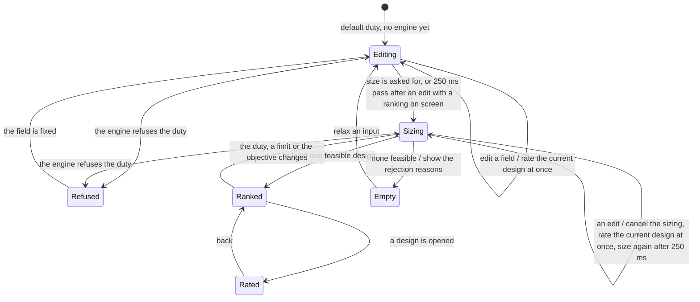

# Screens and actions, for the design lane

Every screen is drawn at two sizes, 1440 and 390, in one light theme. There is no dark theme and no theme
switch. Screens are Blocks screens; the tower is an island. The design lane decides the look and the layout.
This list fixes what each screen holds, what the user can do, and which states need a mockup. Numbers shown are
the engine's; a mockup uses the default duty on the synthetic catalog.

## Shared

| Element | Holds | Actions |
|---|---|---|
| Header | product name, link to the wizard | go home, start sizing |
| Notice | "Synthetic catalog. Not CTI certified." on every screen that shows a number | open the limitations page |
| Tower island | the 3D tower, or its poster | open full view, toggle cutaway |
| Refusal | the engine's message in plain words, and the field it names | fix the field |
| Not found | a way back | go home |

## 1. Landing page (`/`)

- **Holds:** a headline and one line of what the tool does; the tower; a start button; three short blocks (enter
  the duty, see ranked towers, read every calc step); one sample calc step with its formula, numbers and result;
  the notice; a footer with the licence, the source link and the version.
- **Actions:** start sizing; open the tower; toggle cutaway.
- **States:** tower as poster (first paint); tower live; tower fallback (no WebGL); reduced motion.
- **Constraint:** the first paint is text and the poster. It must look finished without the live tower.

## 2. Wizard step 1: duty (`/size/`)

- **Holds:** water flow (m3/h), hot water, cold water wanted, wet bulb, dry bulb, site pressure or altitude;
  live read-outs of range, approach and heat load; the tower beside the form at 1440 and as a strip above it at 390.
- **Actions:** edit a field (slider or typed); next; reset to the default duty.
- **States:** valid; a field out of range; temperatures in the wrong order (hot, cold, wet bulb); engine loading
  on the first edit; tower following a dragged slider.

## 3. Wizard step 2: site and water (`/size/site/`)

- **Holds:** water quality class, cycles of concentration, salinity; limits on footprint, electrical input and
  drift; the thermal margin wanted. Each has the engine's default.
- **Actions:** edit; back; next; clear a limit.
- **States:** defaults untouched; a limit set; a value the engine refuses.

## 4. Wizard step 3: priority (`/size/priority/`)

- **Holds:** the four objectives as one choice, each with a line on what it favours: least over-capacity,
  lowest electrical input, lowest make-up water, lowest air-side pressure.
- **Actions:** choose; back; size.

## 5. Results and ranking (`/size/results/`)

- **Holds:** the duty in one line with an edit link; the ranked designs as a table at 1440 and as cards at 390:
  rank, cell, fill and depth, fan and speed, cold water, margin, capability, electrical input, make-up water,
  air-side pressure, footprint; the count of feasible designs; why the others were rejected, by reason and count;
  the tower of the selected row.
- **Actions:** select a row (the tower reshapes); open a design; change the objective (the list re-ranks); edit
  the duty; show more rows.
- **States:** sizing in progress with the last ranking kept and marked as updating, while the tower and the
  numbers of the selected design already show the new duty; ranked; no feasible design, with the rejection
  reasons and what to relax; refused duty.

## 6. Design and calc steps (`/size/design/?d=<design>`)

- **Holds:** the design's parts by name; the eleven headline numbers; the calc sheet in sections (duty, air
  side, fan, heat transfer, fill layers, water), each step with its label, why it is computed, the formula, the
  numbers substituted, the result with its unit, and the reference; the pressure by zone; the fan and system
  curves with the operating point; the fill layers table; the water balance; the tower.
- **Actions:** open and close a section; open the tower; pick a part in the tower to jump to its steps; back to
  the ranking; previous and next design; copy a link to this design.
- **States:** rated; the design cannot hold the duty (the limits it hit); long sheet at 390.

## 7. 3D tower view (full screen from any screen, `?tower=open`)

- **Holds:** the tower; a cutaway slider; switches for air, water and labels; a part card (name, record,
  dimensions with their formulas) for the picked part; the overall size.
- **Actions:** orbit, zoom and pan by pointer and by touch; move the cutaway; switch air, water and labels; pick
  a part; reset the view; pause motion; close.
- **States:** loading over the poster; live; morphing to a new design; paused; fallback with the poster and the
  dimension table; reduced motion; the smallest quality tier on a phone.

## States of the wizard

The wizard is one state value and one reducer in `packages/wizard`. The step is the route; the rest is this chart.

Rating runs beside this chart, in its own worker: in every state an edit or a picked row is rated at once and
the tower follows. A ranking on screen while `Sizing` is kept and marked as updating. The selected design is
kept across a new ranking when it is still in it; otherwise rank 1 is selected.

## Embedded in a host app

The host shows screens 2 to 7 without the header, the landing page and the footer, inside its own page. The
design lane draws one mockup of the wizard inside a plain host frame at 1440 to fix the outer spacing.
