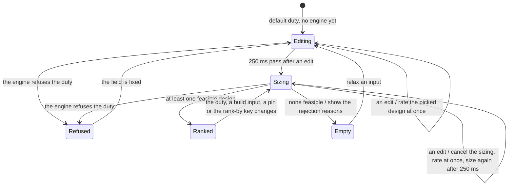

# Screens and actions

Drafthouse is one cockpit screen, drawn at 1440 and 390. It has no landing page, hero, footer and no wizard
pages. Every edit re-rates the picked design at once and re-ranks the rest; nothing waits for a "next" button.
The approved mockups are in [docs/design/restart/](../../design/restart/README.md). They use the website theme
tokens: dark by default, with light as a toggle. Numbers shown are the engine's. A mockup uses the default duty
on the synthetic catalog.

## The cockpit (`/`)

| Region | Holds | Actions |
|---|---|---|
| Top bar | scenario menu, undo and redo, 3D or GA, Compare (n of 3), Share, the notice "Synthetic catalog. Not CTI certified.", theme toggle | open, save as and share a scenario; undo or redo (⌘Z); switch view; open compare; toggle the theme |
| Left dock, Duty tab | water flow, hot water, cold water wanted, wet bulb, dry bulb, altitude; range, approach and heat load read-outs | edit a field (slider or typed); reset to the default duty |
| Left dock, Build tab | identical cells in a row; structure (FRP, steel, concrete) with its load code (Thai DPT 1311 and 1301 by default, or ASCE 7) and that code's site inputs; the fill layer stack, top first | step the cell count; pick a structure; pick a load code and edit its site inputs; add, remove and drag to reorder a layer; pick a layer's fill; set its depth in that fill's module steps |
| Centre stage | the 3D tower (cells, fill bands, fans, drift eliminators, nozzles, casing, basin), dimension lines, water and air; or the GA sheet (plan, elevation, section, title block) | orbit, zoom and pan; click a part for its card and formula; views 1–4; Fit (F) |
| Parts tray | fills, drift eliminators, fans, nozzles, casing | drag a part onto the tower to pin it; drag a pin off to unpin; P pins the picked part |
| Right dock, Ranking | count that holds the duty; the rank-by key (the list sorts by it, shown on its column); pins in force; ranked rows (design, margin, kW) | pick the rank-by key; pick a row (the tower reshapes); show all; clear a pin |
| Right dock, Picked | the picked design's name and its headline numbers, each tweening to a new value with its delta | add to compare (C); step to the next or previous rank |
| Bottom drawer, Calc | sections (duty, cells, air side, fan, heat transfer, fill layers, water, structure); each step has its why, formula, substituted numbers, result and reference; a chart or table beside it | open a section; jump to a part's steps from the tower |
| Bottom drawer, Compare | up to 3 designs side by side with a line thumbnail, their numbers and "best" tags | add, remove, pick one |

## States to draw

Each state at 1440 and 390, unless it names a size.

| State | What it shows |
|---|---|
| Default | rank 1 picked, the fan picked on the tower |
| GA | the GA sheet of the picked design |
| First paint | the poster line drawing before WebGL |
| Light | the light toggle |
| Refused duty | the red field, the plain-word reason, two fixes, the last design that held, dimmed |
| Fill layers | a layer added; the ranking re-ranks under skeleton rows |
| 3 cells | three cells in 3D, and the 3-cell GA sheet |
| Structure | steel picked with the Thai DPT load code: the calc drawer's structure steps and member checks; the Build sheet at 390; the same with ASCE 7 at 1440 and 390 |
| Parts | a pinned fan, and a fill refused in plain words |
| Compare | three designs in the compare tray, with the scenario menu open |
| Phone sheets (390) | Inputs, Build, Ranking, Calc, Parts and Compare as bottom sheets, one at a time, over a full-screen tower |

## States of the cockpit

The cockpit is one state value and one reducer in `packages/wizard`. The package keeps its name; it holds the
cockpit's state and its Blocks panels.

Rating runs beside this chart, in its own worker: in every state an edit or a picked row is rated at once and
the tower follows. A ranking on screen while `Sizing` is kept under skeleton rows. The picked design is kept
across a new ranking when it is still in it; otherwise rank 1 is picked. Every edit pushes onto the undo stack.

## Embedded in a host app

The host shows the cockpit without the top bar's scenario menu and Share, inside its own page. The mockups in
`docs/design/restart/` fix the cockpit itself; the host's outer frame is the host's design.
