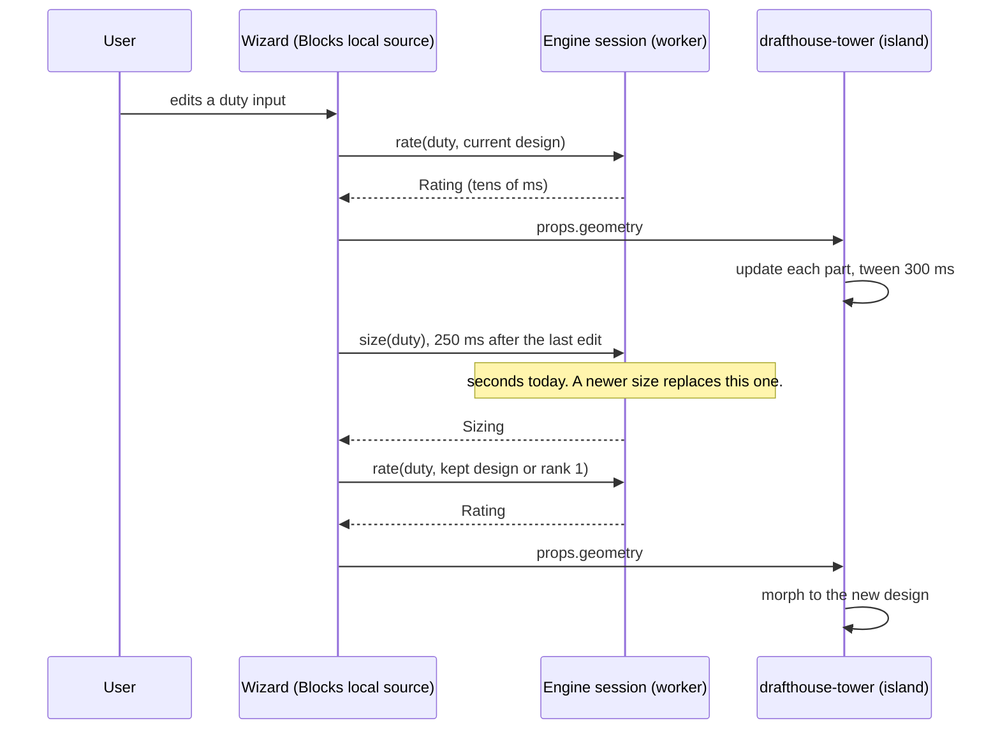
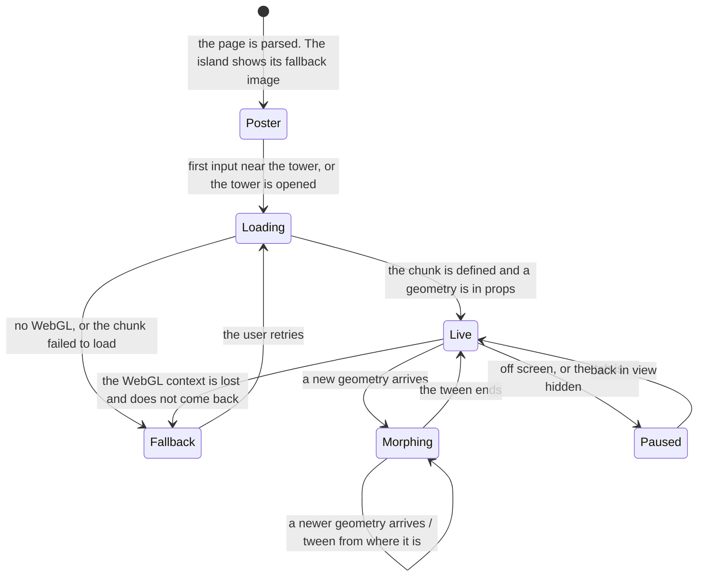

# The 3D tower

The engine emits `TowerGeometry` ([shapes.md](shapes.md) section 3). `packages/tower3d` turns it into a Three.js
scene. There is no model file, no texture file and no environment file: every mesh is built from numbers.

## 1. How the scene maps the geometry

One geometry field, one file in `packages/tower3d/src/parts/`, one scene object.

| Geometry | Scene object | Technique | Motion |
|---|---|---|---|
| `cell.basin` | floor slab, water surface | box; a plane with a small ripple shader | ripple |
| `cell.shell` | four casing walls | boxes with the cutaway clipping plane, open at the inlets | none |
| `cell.inlets` | louver slats | one instanced mesh per face | none |
| `cell.fill` | corrugated sheets per block and layer | one instanced mesh; colour by `recordId` | none |
| `cell.nozzles` | header pipes, nozzle cones | cylinders; one instanced mesh of `count` cones on the `rows` by `columns` grid | spray |
| `cell.drift` | chevron blades per panel | one instanced mesh | none |
| `cell.plenum` | nothing solid | it bounds the air particles | none |
| `cell.fan` | hub, `bladeCount` blades, the flared stack | extruded blade shape; lathe for the stack | spins at `rpm`, capped for the eye |
| `cell.drive` | gearbox, motor | cylinder and box | none |
| `flows.water` | water particles | one points cloud along each path; colour from `fromC` to `toC` | falls at `speedMS` |
| `flows.air` | air particles | one points cloud along each path | moves at `speedMS` |
| `dimensions` | labels and the part card | HTML over the canvas, not in the scene | none |
| `size` | camera framing and orbit limits | fit the box, keep the user's angle | eased |

- **Cutaway.** One clipping plane through the tower, moved by a slider from 0 (closed) to 1 (half open). Walls,
  fill and drift are clipped; fan, nozzles and particles are not, so the inside reads at once.
- **One renderer, one loop.** WebGL only. The loop stops when the tower is off screen or the tab is hidden.
- **Quality.** Three tiers by device: particle counts, pixel ratio (capped at 2) and shadows. With
  `prefers-reduced-motion` the fans and particles stand still.
- **Picking.** A tap on a part sends the island event `pick` with its `recordId`. The wizard shows the part card.

## 2. The live-update path

- A change of inputs that keeps the design moves only numbers, particles and fan speed: one `rate` call.
- A change of design (the user picks another row, or the ranking changes) reshapes the tower: each part's
  `update` moves and resizes the objects it already has. A part is rebuilt only when a count changes (blades,
  nozzles, layers, panels).
- While `size` runs, the tower shows the last rating and the wizard marks the ranking as updating.
- The tower never calls the engine. It draws what its props say.

## 3. States of the tower view

`Fallback` shows the poster and the dimension table. The numbers never depend on WebGL.

## 4. Speed of the update

`rate` is fast enough today. `size` is not: 2.5 s natively for the default duty, more in WASM. The design
absorbs that (the worker, newest call wins, the two-beat update) and issue R2 brings it under one second. Two
routes are open without a change to the API: split the catalog by tower across workers, and remove repeated work
inside the capacity solve. Neither may move a recorded number.
